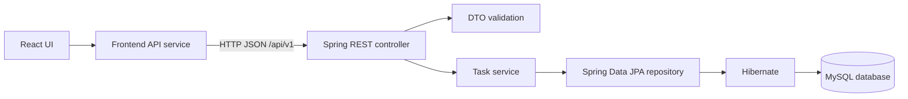

# Student Task Manager

A beginner-friendly full-stack study planner for organizing assignments, coding practice, exams, and revision. The application uses a React interface to manage tasks through a Spring Boot REST API, with MySQL storing the task data.

> This is a local, single-user learning project. Authentication and cloud deployment are not implemented.

## Problem and objectives

Students often track deadlines and study activities in different places. This project provides one place to record tasks, check what is due, and update progress.

The project is also designed as a Java full-stack learning exercise. It demonstrates:

- Building a React interface with reusable components and hooks.
- Connecting a frontend to a REST API using JSON.
- Organizing backend code into controllers, services, repositories, DTOs, and entities.
- Validating input and persisting task data with Spring Data JPA and MySQL.

## Implemented features

- Create, view, edit, and delete study tasks.
- Update a task's status directly from its card.
- Store a title, optional description and due date, priority, status, and activity type.
- Search task titles and filter by status, activity type, priority, and overdue state.
- Sort by due date, priority, or creation date.
- Show total, pending, in-progress, completed, and overdue task counts.
- Validate task forms in the browser and validate requests in the backend.
- Confirm before deleting a task and show success/error notifications.
- Switch between light and dark themes; the selected theme is saved in browser storage.
- Use responsive styling for smaller screens.

### Task values

| Field | Values or rules |
|---|---|
| Title | Required; 3–100 characters |
| Description | Optional; up to 1,000 characters |
| Due date | Optional; new tasks cannot have a past due date; existing overdue tasks can still be edited |
| Priority | `LOW`, `MEDIUM`, or `HIGH` |
| Status | `PENDING`, `IN_PROGRESS`, or `COMPLETED` |
| Activity type | `ASSIGNMENT`, `CODING_PRACTICE`, `EXAM`, or `REVISION` |

## Technology stack

| Area | Technology in this project |
|---|---|
| Frontend | React 19, JavaScript, Vite 8 |
| Backend | Java 25, Spring Boot 4.1.1, Spring Web MVC, Spring Data JPA, Bean Validation |
| Database | MySQL 8.x, MySQL Connector/J |
| Testing | JUnit 5, Mockito, Spring Boot test support |
| Build tools | npm, Maven Wrapper (`mvnw` / `mvnw.cmd`) |

The project sets the Java compilation version to 25 in `backend/pom.xml`. Spring Boot 4.1.1 supports Java 17 through 26; this project therefore requires JDK 25 to compile with its current setting. See the [Spring Boot system requirements](https://docs.spring.io/spring-boot/system-requirements.html).

Vite 8 requires Node.js 20.19+ or 22.12+. See the [Vite setup guide](https://vite.dev/guide/). The package manifest declares React and React DOM `^19.2.8` and Vite `^8.3.0`; the lockfile installs compatible versions when using `npm ci`.

## Screenshots

Screenshots are not included yet. Add application screenshots to this section when available.

<!-- Suggested placeholders: Dashboard, task search and filters, create/edit task dialog, mobile layout. -->

## Architecture and request flow



For example, creating a task follows this path:

1. The user submits the task form.
2. The frontend checks form values and sends a `POST` request through `frontend/src/services/api.js`.
3. Spring routes the request to `TaskController` and validates the request DTO.
4. `TaskServiceImpl` maps the DTO to a `Task` entity and calls the repository.
5. Spring Data JPA and Hibernate save the task in MySQL.
6. The API returns a response DTO, and the frontend refreshes the task list and dashboard counts.

## Project structure

```text
Student-Task-Manager/
├── backend/
│   ├── src/main/java/com/example/studenttaskmanager/
│   │   ├── config/          # Web and CORS configuration
│   │   ├── controller/      # REST endpoints
│   │   ├── exception/       # API error responses and exception handling
│   │   ├── model/
│   │   │   ├── dto/         # API request and response objects
│   │   │   ├── entity/      # JPA Task entity
│   │   │   └── enums/       # Priority, status, and task type values
│   │   ├── repository/      # Database access and task filtering queries
│   │   └── service/         # Task operations and business rules
│   ├── src/main/resources/application.properties
│   ├── src/test/            # Controller, service, repository, and context tests
│   ├── mvnw                 # Maven Wrapper for Unix-like shells
│   ├── mvnw.cmd             # Maven Wrapper for Windows
│   └── pom.xml
├── docs/
│   ├── api-spec.md
│   ├── architecture.md
│   ├── database.md
│   └── requirements.md
├── frontend/
│   ├── src/
│   │   ├── components/      # Task cards, forms, controls, dashboard, dialogs
│   │   ├── services/api.js  # Centralized API requests
│   │   ├── App.jsx           # Main page state and application flow
│   │   └── *.css             # Application and theme styles
│   ├── package.json
│   ├── package-lock.json
│   └── vite.config.js
├── AGENTS.md
└── README.md
```

## Prerequisites

- **JDK 25** (the backend is configured to compile for Java 25).
- **Node.js 20.19+ or 22.12+** and npm (Vite 8 requirement).
- **MySQL Server 8.x** running locally.
- A terminal and Git. The project includes Maven Wrapper scripts, so a separate Maven installation is not required.

Check your installed versions:

```powershell
java -version
node --version
npm --version
```

## MySQL setup

The backend expects a database named `student_task_manager` by default. Create it in MySQL Workbench or connect with the MySQL command-line client and run:

```sql
CREATE DATABASE student_task_manager
  CHARACTER SET utf8mb4
  COLLATE utf8mb4_unicode_ci;
```

Hibernate is configured with `spring.jpa.hibernate.ddl-auto=update`, so it creates or updates the task table when the backend starts. It does not create the MySQL database itself. The database design document describes the intended table and indexes in [`docs/database.md`](docs/database.md).

## Configure database environment variables

The backend reads database connection settings from environment variables. These PowerShell examples apply to the current terminal session only. Replace the username and password values with your local MySQL account details; do not commit credentials.

```powershell
$env:DB_HOST = "localhost"
$env:DB_PORT = "3306"
$env:DB_NAME = "student_task_manager"
$env:DB_USERNAME = "your_mysql_username"
$env:DB_PASSWORD = "your_local_mysql_password"
```

If these variables are not set, the application defaults to localhost, port 3306, database `student_task_manager`, username `root`, and an empty password. Set the variables before starting the backend, in the same terminal session.

## Run locally

### 1. Start the backend

Open PowerShell in the project folder. Set the database environment variables as described above, then run:

```powershell
cd backend
.\mvnw.cmd spring-boot:run
```

The API listens on `http://localhost:8080`.

### 2. Start the frontend

Open a second terminal in the project folder and run:

```powershell
cd frontend
npm ci
npm run dev
```

Open the local URL printed by Vite (the configured development port is `5173`). The Vite development server proxies `/api` requests to the backend at `http://localhost:8080`.

### Useful commands

Run these commands from the relevant folder:

| Purpose | Folder | Command |
|---|---|---|
| Start frontend development server | `frontend/` | `npm run dev` |
| Lint frontend | `frontend/` | `npm run lint` |
| Build frontend for production | `frontend/` | `npm run build` |
| Preview frontend build | `frontend/` | `npm run preview` |
| Start backend | `backend/` | `./mvnw spring-boot:run` or `mvnw.cmd spring-boot:run` on Windows |
| Run backend tests | `backend/` | `./mvnw test` or `mvnw.cmd test` on Windows |

## Implemented REST API

Base URL: `http://localhost:8080/api/v1`

| Method | Endpoint | Purpose | Success response |
|---|---|---|---|
| `GET` | `/tasks` | List tasks; optional query parameters: `search`, `status`, `taskType`, `priority`, `overdue`, `sortBy` | `200 OK` with task list |
| `GET` | `/tasks/{id}` | Get one task | `200 OK` with task, or `404 Not Found` |
| `POST` | `/tasks` | Create a task | `201 Created` with task |
| `PUT` | `/tasks/{id}` | Update a task | `200 OK` with task, or `404 Not Found` |
| `PATCH` | `/tasks/{id}/status` | Update only task status | `200 OK` with task, or `404 Not Found` |
| `DELETE` | `/tasks/{id}` | Delete a task | `204 No Content`, or `404 Not Found` |
| `GET` | `/dashboard/stats` | Get total, pending, in-progress, completed, and overdue counts | `200 OK` with statistics |

Tasks use ISO-style local date-time strings such as `2026-10-18T14:30:00`; an optional missing due date is sent as `null`. For details and examples, see [`docs/api-spec.md`](docs/api-spec.md).

## Validation, errors, and tests

- The frontend validates the title length and description length and checks new task due dates.
- Backend DTO validation checks task fields. New tasks cannot have a past due date; updates allow existing overdue tasks to be edited.
- The API returns structured JSON for validation errors, malformed requests, missing tasks, and unexpected errors. Unexpected errors are logged on the server and returned with a general message.
- Backend tests cover controller responses, service behavior, repository filters/sorting, dashboard counts, and application startup.
- Frontend scripts include linting and a production build. No frontend automated test script is currently configured.

Run checks with:

```powershell
# From frontend/
npm run lint
npm run build

# From backend/
.\mvnw.cmd test
```

## Current limitations

- The application is a local, single-user Phase 1 project; it has no login or user accounts.
- Tasks are not grouped into courses or subjects.
- Task lists are returned without pagination, which is appropriate for a small learning project but may need to change for large datasets.
- There is no separate task details page; descriptions can be expanded on task cards.
- Hibernate updates the schema automatically for local development; no migration tool or versioned migration scripts are configured.
- Screenshots and frontend automated tests are not currently included.

## Future enhancements

These items are planned in the project roadmap and are not implemented yet:

- Course and subject organization with task relationships.
- A lightweight daily checklist mode.
- Study analytics and completion trend charts.
- Authentication and multi-user support.
- Containerized deployment and cloud hosting.
- Frontend automated tests and documented screenshots.

## Author and repository

- **Author:** [amit-prasad-dev](https://github.com/amit-prasad-dev)
- **GitHub repository:** [Student-Task-Manager](https://github.com/amit-prasad-dev/Student-Task-Manager)

## Project documentation

- [Requirements](docs/requirements.md)
- [Architecture](docs/architecture.md)
- [Database design](docs/database.md)
- [API specification](docs/api-spec.md)
- [Contributor and learning guide](AGENTS.md)
