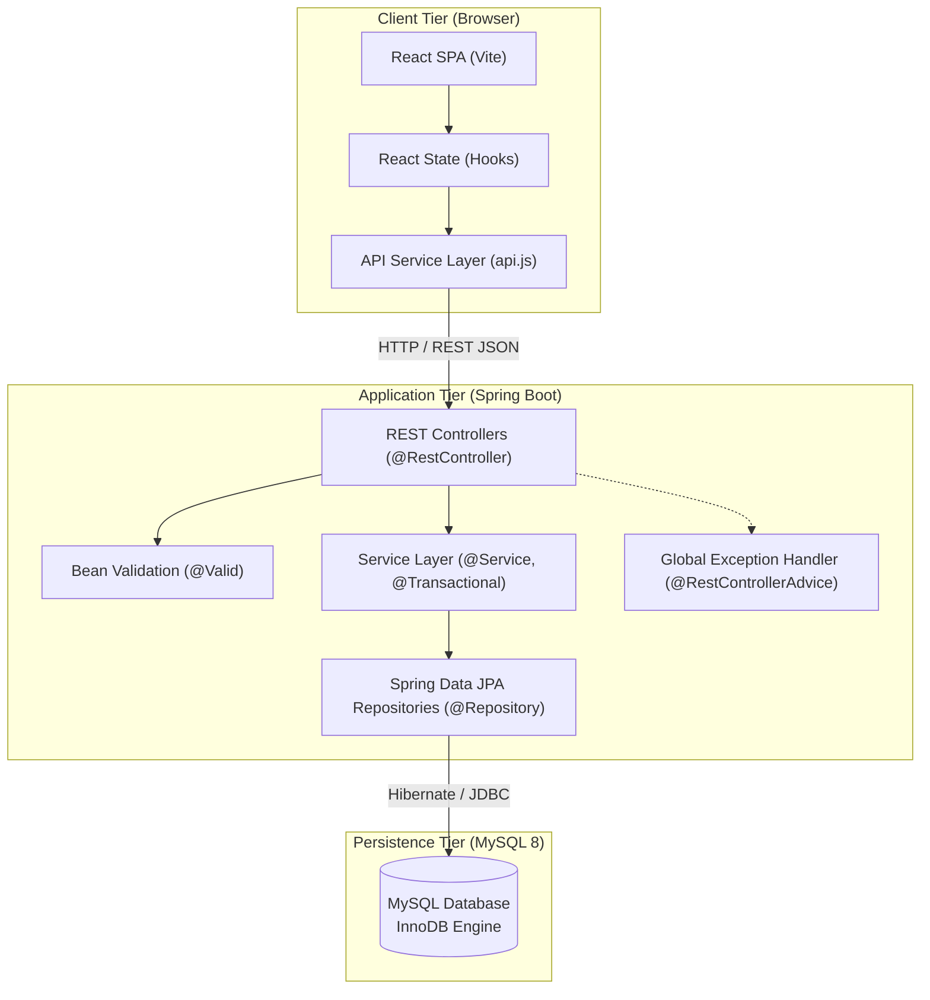

# System Architecture & Technical Design

## 1. High-Level Architecture Overview

The **Student Task Manager** uses a decoupled **Client-Server Architecture**. The React single-page application (SPA) communicates asynchronously with the Spring Boot backend server through a stateless **RESTful JSON API**.



---

## 2. Frontend Architecture (React + Vite)

### 2.1 Design Pattern
The frontend utilizes a modular, component-based architecture using **React functional components** and standard **React Hooks** (`useState`, `useEffect`, `useMemo`, `useCallback`).

### 2.2 Phase 1 Component Hierarchy

```text
App (Root container, theme provider, global notification toast)
├── Navbar (App branding, "New Study Task" button, light/dark theme toggle)
├── DashboardView (Summary statistics bar)
│   └── StatCard (Metric cards: Total, Pending, In-Progress, Completed, Overdue)
├── TaskListView (Main study planner workspace)
│   ├── TaskControls
│   │   ├── SearchBar (Keyword search matching task title)
│   │   ├── StatusFilterPills (ALL, PENDING, IN_PROGRESS, COMPLETED)
│   │   ├── TaskTypeDropdown (ALL, ASSIGNMENT, CODING_PRACTICE, EXAM, REVISION)
│   │   ├── OverdueToggleCheckbox (Quick filter for overdue items)
│   │   └── SortSelect (Due Date, Priority, Creation Date)
│   ├── TaskGrid / TaskList (Container rendering task items)
│   │   └── TaskCard (Type badge, priority pill, status toggle, due date indicator, action menu)
│   ├── TaskModal (Create / Edit task modal with form validation)
│   └── ConfirmModal (Delete confirmation dialog preventing accidental data loss)
```

*(Note: Course management views and visual chart components will be added in Phase 2 and Phase 3).*

### 2.3 Centralized API Service Layer
Components never execute direct `fetch()` calls. All network requests are routed through `services/api.js`.
- **Benefits**:
  - Single location for API base URL (`http://localhost:8080/api/v1`).
  - Standard headers (`Content-Type: application/json`).
  - Unified handling for JSON decoding and error messages.
  - **Date Input Sanitization**: Form inputs (`<input type="datetime-local" />`) leave empty strings `""` when cleared. The service layer converts blank strings to `null` (`dueDate: dateValue || null`) before sending the JSON payload, preventing Jackson deserialization exceptions.

---

## 3. Backend Architecture (Java + Spring Boot)

### 3.1 Layered Responsibilities

| Layer | Key Annotations / Types | Core Responsibility |
|---|---|---|
| **Presentation** | `@RestController`, `@RequestMapping`, `@CrossOrigin` | Receives HTTP requests, validates incoming DTOs (`@Valid`), returns HTTP response status codes. Manages CORS configuration allowing `http://localhost:5173` and explicit HTTP methods (`GET`, `POST`, `PUT`, `PATCH`, `DELETE`, `OPTIONS`). |
| **Business Logic** | `@Service`, `@Transactional` | Implements business rules (overdue calculations, dashboard aggregation, priority sorting logic, validation checks). |
| **Data Access** | `@Repository`, `JpaRepository<Task, Long>` | Translates repository method calls into SQL queries executed against MySQL via Hibernate. |
| **Domain Entity** | `@Entity`, `@Table`, `@Id`, `@Enumerated` | Represents the database table `tasks`. Managed by JPA/Hibernate. |
| **Data Transfer Objects** | Plain Java Classes / Records | `TaskCreateDTO`, `TaskUpdateDTO`, `TaskResponseDTO`, `DashboardStatsDTO`. Isolate the database schema from the client API contract. |
| **Exception Handling** | `@RestControllerAdvice`, `@ExceptionHandler` | Intercepts validation errors and entity-not-found exceptions, returning uniform error JSON. |

### 3.2 The DTO Pattern & Separate Validation Rules

```text
[HTTP Request: POST]                         [HTTP Request: PUT]
        │                                            │
        ▼                                            ▼
   [TaskCreateDTO]                              [TaskUpdateDTO]
(enforces @FutureOrPresent)                   (omits @FutureOrPresent)
        │                                            │
        └─────────────────────┬──────────────────────┘
                              ▼
                        [TaskService] ─── (Maps DTO to Entity) ───► [Task Entity]
                                                                          │
                                                                   (Hibernate saves)
                                                                          ▼
                                                                   [MySQL Database]
                                                                          │
                                                                   (Hibernate loads)
                                                                          ▼
                        [TaskService] ◄─── (Maps Entity to DTO) ─── [Task Entity]
                              │
                              ▼
                      [TaskResponseDTO]
                              │
                              ▼
                    [HTTP Response Body]
```

**Why DTOs & Validation Separation are Crucial**:
1. **Creation vs Update Validation**:
   - When **creating** a task (`TaskCreateDTO`), a provided `dueDate` must not be in the past (`@FutureOrPresent`).
   - When **updating** an existing task (`TaskUpdateDTO`), we validate string formats and lengths, but **omit `@FutureOrPresent`**. This ensures a student can edit an existing overdue task (e.g., updating notes, changing priority, or marking progress) without Spring Boot throwing a validation error on the existing past deadline.
2. **Separation of Concerns**: The database structure (`@Entity`) is kept independent from what the frontend sends and receives (`DTO`).
3. **Security**: Prevents mass-assignment vulnerabilities (clients cannot inject fields like auto-generated IDs or creation timestamps).
4. **Calculated Fields**: Transient properties (e.g., `isOverdue: boolean`) are computed dynamically in `TaskResponseDTO`.

---

## 4. Phase 1 Domain Models, Enums & Custom Sorting

### 4.1 Enums
- **`TaskType`**: `ASSIGNMENT`, `CODING_PRACTICE`, `EXAM`, `REVISION`
- **`TaskStatus`**: `PENDING`, `IN_PROGRESS`, `COMPLETED`
- **`Priority`**: `LOW`, `MEDIUM`, `HIGH`

### 4.2 Priority Sorting Architecture (Business Order vs Database Alphabetical Order)
In MySQL, `priority` is stored as `VARCHAR(20)`. Naive alphabetical sorting sorts `HIGH`, `LOW`, `MEDIUM` ('H', 'L', 'M'), which incorrectly places `MEDIUM` after `LOW` in descending order!

To respect academic urgency, priority sorting is implemented using custom JPQL ordering or service-layer comparators:
- **Priority Descending (`priority,desc`)**:
  `ORDER BY CASE t.priority WHEN 'HIGH' THEN 1 WHEN 'MEDIUM' THEN 2 WHEN 'LOW' THEN 3 END ASC`
  Result order: **`HIGH` $\rightarrow$ `MEDIUM` $\rightarrow$ `LOW`**
- **Priority Ascending (`priority,asc`)**:
  `ORDER BY CASE t.priority WHEN 'HIGH' THEN 1 WHEN 'MEDIUM' THEN 2 WHEN 'LOW' THEN 3 END DESC`
  Result order: **`LOW` $\rightarrow$ `MEDIUM` $\rightarrow$ `HIGH`**

### 4.3 Nullability & Validation Rules
- `title`: Mandatory (length 3–100 characters).
- `description`: Optional (up to 1000 characters).
- `dueDate`: Optional. When supplied on **creation**, must be future or present date/time. On **update**, existing past dates are permitted.
- `priority`: Mandatory (defaults to `MEDIUM` if omitted).
- `status`: Mandatory (defaults to `PENDING` if omitted).
- `taskType`: Mandatory (defaults to `ASSIGNMENT` if omitted).

---

## 5. End-to-End Request Lifecycle Example

Let us trace what occurs when a student clicks **"Create Task"**:

1. **User Action**: The user fills the form in `TaskModal.jsx` and clicks **Save**.
2. **Client Validation**: React verifies the title has at least 3 characters and the due date (if provided) is valid.
3. **API Dispatch**: `taskService.createTask(payload)` issues a `POST /api/v1/tasks` with JSON payload.
4. **Endpoint Interception**: Spring Boot's `DispatcherServlet` directs the request to `TaskController.createTask()`.
5. **Bean Validation**: `@Valid` checks field constraints on `TaskCreateDTO`. If invalid, `GlobalExceptionHandler` immediately returns `400 Bad Request` with field-specific errors.
6. **Service Execution**: `TaskService.createTask()` maps the DTO into a `Task` entity and sets timestamps.
7. **Database Persistence**: `TaskRepository.save(task)` triggers Hibernate to execute an `INSERT INTO tasks ...` SQL statement.
8. **DTO Conversion**: The persisted entity is converted to `TaskResponseDTO` (computing `isOverdue`).
9. **HTTP Response**: `TaskController` returns `201 Created` with the JSON object.
10. **UI Update**: React appends the task to state, refreshes dashboard summary counts, shows a toast notification, and closes the modal.
