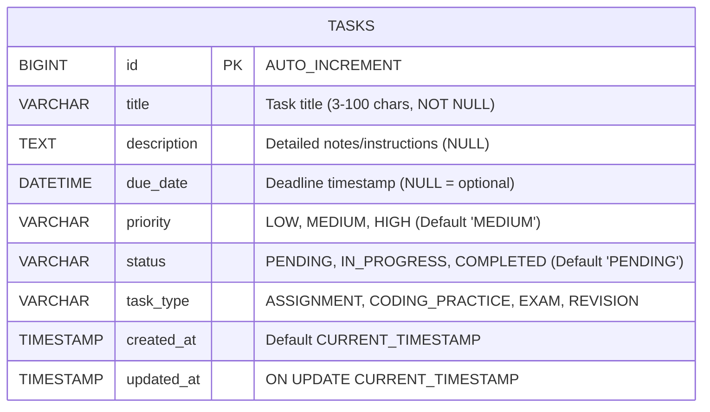

# Database Design & Schema Specification

## 1. Overview
The **Student Task Manager** uses **MySQL 8.x** with the **InnoDB storage engine**, ensuring ACID compliance and high performance.

- **Character Set**: `utf8mb4` (full Unicode support for special characters and emojis)
- **Collation**: `utf8mb4_unicode_ci`

---

## 2. Phase 1 Entity Design: `tasks`

In **Phase 1 (Student Study Planner)**, we deliberately adopt a clean, focused single-table architecture centered on student study tasks. This keeps early backend development approachable and beginner-friendly before introducing multi-table joins.



---

## 3. Data Dictionary: `tasks` Table

| Column Name | Data Type | Nullable | Key / Constraints | Default Value | Description |
|---|---|---|---|---|---|
| `id` | `BIGINT` | NO | `PRIMARY KEY`, `AUTO_INCREMENT` | N/A | Unique identifier for each task |
| `title` | `VARCHAR(100)` | NO | None | N/A | Short, descriptive title of the task |
| `description` | `TEXT` | YES | None | `NULL` | Optional detailed study notes or instructions |
| `due_date` | `DATETIME` | YES | `INDEX` | `NULL` | Optional deadline for the task |
| `priority` | `VARCHAR(20)` | NO | `INDEX` | `'MEDIUM'` | Priority level: `'LOW'`, `'MEDIUM'`, `'HIGH'` |
| `status` | `VARCHAR(20)` | NO | `INDEX` | `'PENDING'` | Status: `'PENDING'`, `'IN_PROGRESS'`, `'COMPLETED'` |
| `task_type` | `VARCHAR(30)` | NO | `INDEX` | `'ASSIGNMENT'` | Activity type: `'ASSIGNMENT'`, `'CODING_PRACTICE'`, `'EXAM'`, `'REVISION'` |
| `created_at` | `TIMESTAMP` | NO | None | `CURRENT_TIMESTAMP` | System creation timestamp |
| `updated_at` | `TIMESTAMP` | NO | None | `CURRENT_TIMESTAMP ON UPDATE CURRENT_TIMESTAMP` | System last modification timestamp |

---

## 4. Performance Indexes

1. **`idx_tasks_status`**: Accelerates dashboard summary counts (e.g., `COUNT(*) WHERE status = 'PENDING'`) and tab-based status filtering.
2. **`idx_tasks_task_type`**: Fast filtering when students view only specific task categories (e.g., Coding Practice).
3. **`idx_tasks_due_date`**: Speeds up deadline sorting and overdue queries (`due_date < NOW() AND status != 'COMPLETED'`).
4. **`idx_tasks_priority`**: Accelerates priority-filtered queries. (Note: Sorting by priority uses JPQL `CASE` mapping to enforce business order `HIGH` (1) $\rightarrow$ `MEDIUM` (2) $\rightarrow$ `LOW` (3) rather than alphabetical string sorting).

---

## 5. DDL Script (Phase 1 MySQL Schema)

```sql
-- 1. Create Database if not exists
CREATE DATABASE IF NOT EXISTS student_task_manager
  CHARACTER SET utf8mb4
  COLLATE utf8mb4_unicode_ci;

USE student_task_manager;

-- 2. Create tasks table
CREATE TABLE IF NOT EXISTS tasks (
    id BIGINT AUTO_INCREMENT PRIMARY KEY,
    title VARCHAR(100) NOT NULL,
    description TEXT NULL,
    due_date DATETIME NULL,
    priority VARCHAR(20) NOT NULL DEFAULT 'MEDIUM',
    status VARCHAR(20) NOT NULL DEFAULT 'PENDING',
    task_type VARCHAR(30) NOT NULL DEFAULT 'ASSIGNMENT',
    created_at TIMESTAMP NOT NULL DEFAULT CURRENT_TIMESTAMP,
    updated_at TIMESTAMP NOT NULL DEFAULT CURRENT_TIMESTAMP ON UPDATE CURRENT_TIMESTAMP,
    
    INDEX idx_tasks_status (status),
    INDEX idx_tasks_task_type (task_type),
    INDEX idx_tasks_due_date (due_date),
    INDEX idx_tasks_priority (priority)
) ENGINE=InnoDB;
```

---

## 6. Sample Initial Seed Data (Phase 1)

```sql
INSERT INTO tasks (title, description, due_date, priority, status, task_type) VALUES
('LeetCode 75: Binary Tree Traversal', 'Practice In-order, Pre-order and Post-order recursive and iterative solutions.', DATE_ADD(NOW(), INTERVAL 1 DAY), 'HIGH', 'IN_PROGRESS', 'CODING_PRACTICE'),
('Data Structures Lab 3 Assignment', 'Submit Java code with complete JUnit test suite and complexity write-up.', DATE_ADD(NOW(), INTERVAL 3 DAY), 'HIGH', 'PENDING', 'ASSIGNMENT'),
('Calculus Midterm Exam Preparation', 'Review Chapters 3-5: derivatives, chain rule, and optimization problems.', DATE_ADD(NOW(), INTERVAL 5 DAY), 'MEDIUM', 'PENDING', 'EXAM'),
('Database Normalization Revision', 'Revise 1NF, 2NF, 3NF, and BCNF concepts and draw sample ER diagrams.', DATE_ADD(NOW(), INTERVAL 7 DAY), 'LOW', 'PENDING', 'REVISION'),
('Set up Java Development Environment', 'Install JDK 21, Maven, and MySQL Workbench.', DATE_SUB(NOW(), INTERVAL 2 DAY), 'MEDIUM', 'COMPLETED', 'ASSIGNMENT');
```

---

## 7. Future Schema Evolution (Phase 2 & Beyond)

In **Phase 2**, we will introduce the `courses` table and link it to `tasks` via a foreign key:

```sql
-- Planned Phase 2 Table: courses
CREATE TABLE IF NOT EXISTS courses (
    id BIGINT AUTO_INCREMENT PRIMARY KEY,
    code VARCHAR(20) NOT NULL UNIQUE,
    name VARCHAR(100) NOT NULL,
    color VARCHAR(7) NOT NULL DEFAULT '#6366F1',
    created_at TIMESTAMP NOT NULL DEFAULT CURRENT_TIMESTAMP
) ENGINE=InnoDB;

-- Planned Phase 2 Migration on tasks:
-- ALTER TABLE tasks ADD COLUMN course_id BIGINT NULL;
-- ALTER TABLE tasks ADD CONSTRAINT fk_tasks_course FOREIGN KEY (course_id) REFERENCES courses(id) ON DELETE SET NULL;
```

This phased approach allows students to first master single-table CRUD with JPA, and later learn database migrations, foreign keys, and relationship mappings (`@ManyToOne`).
